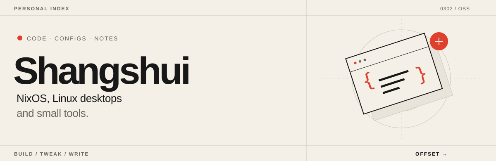
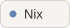
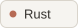
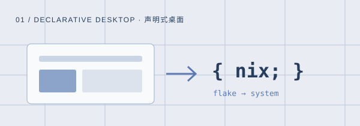
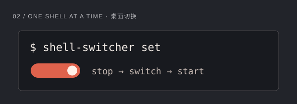
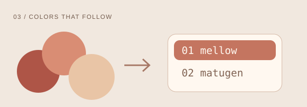
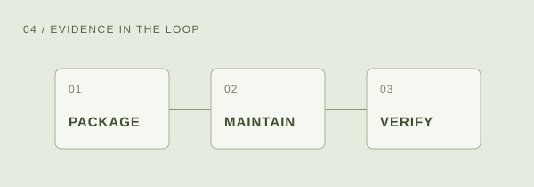
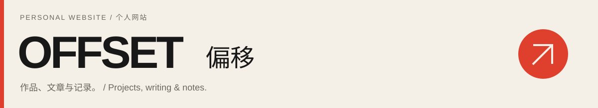

<picture>
  <source media="(prefers-color-scheme: dark)" srcset="assets/header-dark.svg">
  
</picture>

  <a href="https://shangshui0302.github.io/"><strong>偏移 / OFFSET ↗</strong></a>
  &nbsp; · &nbsp;
  <a href="https://shangshui0302.github.io/work/">作品 / Work</a>
  &nbsp; · &nbsp;
  <a href="https://shangshui0302.github.io/writing/">文章 / Writing</a>
  &nbsp; · &nbsp;
  <a href="https://github.com/Shangshui0302?tab=repositories">仓库 / Repos</a>

<h2>你好，我是 Shangshui / Hi, I'm Shangshui</h2>

这里放着我的 NixOS 配置、Linux 桌面小工具，还有一些主题与像素小作品。 
项目的来龙去脉和整理过的技术笔记，放在个人网站 <a href="https://shangshui0302.github.io/">偏移 / OFFSET</a>。

I share my NixOS setup, small Linux desktop tools, themes, and pixel-art projects here. 
For project stories and technical notes, visit my personal website, <a href="https://shangshui0302.github.io/">偏移 / OFFSET</a>.

  
  
  
  
  
  

<h2>01 / Selected work · 几个公开项目</h2>

<table>
  <tr>
    <td width="50%" valign="top">
      
      <h3><a href="https://github.com/Shangshui0302/myNixOSConfig">myNixOSConfig ↗</a></h3>
      
NixOS flakes + Home Manager 配置，记录 Hyprland、niri 与日常桌面的搭建。

      
My NixOS flakes and Home Manager setup for Hyprland, niri, and an everyday Linux desktop.

      
NIXOS · HOME MANAGER · WAYLAND

    </td>
    <td width="50%" valign="top">
      
      <h3><a href="https://github.com/Shangshui0302/shell-switcher">shell-switcher ↗</a></h3>
      
面向 Hyprland / niri 的轻量桌面 shell 切换工具，用 Rust 编排 systemd 用户服务。

      
A lightweight desktop-shell switcher for Hyprland and niri, written in Rust and built around systemd user services.

      
RUST · SYSTEMD · CLI

    </td>
  </tr>
  <tr>
    <td width="50%" valign="top">
      
      <h3><a href="https://github.com/Shangshui0302/fcitx5-mellow-themes-matugen">Mellow × Matugen ↗</a></h3>
      
基于 Mellow 主题，为 Fcitx5 ClassicUI 接入 Matugen 动态重点色，提供深浅两套外观。

      
Matugen-powered accent colors for Fcitx5 ClassicUI, based on Mellow themes, with light and dark variants.

      
FCITX5 · MATUGEN · MATERIAL YOU

    </td>
    <td width="50%" valign="top">
      
      <h3><a href="https://github.com/Shangshui0302/some-NixOS-skills">some-NixOS-skills ↗</a></h3>
      
给 coding agent 使用的 Nix 工作流：包开发、Nixpkgs 维护与 NixOS 配置管理。

      
Nix workflows for coding agents: package development, Nixpkgs maintenance, and NixOS configuration.

      
AGENT SKILLS · NIX · VERIFICATION

    </td>
  </tr>
</table>

<h2>02 / Beyond code · 还有一些小东西</h2>

<a href="https://github.com/Shangshui0302/myCodexPets"><strong>My Codex Pets · 像素桌宠 ↗</strong></a> 
两个个人制作的同人像素桌宠，把喝咖啡、看书和敲键盘变成桌面上的小动画。 
Two personal, fan-made pixel-art companions, with little animations for coffee, reading, and typing.

<a href="https://github.com/Shangshui0302/myWallpaperCollection"><strong>Wallpaper collection · 壁纸收藏 ↗</strong></a> 
壁纸收藏与桌面配色素材。图片版权归原作者所有。 
Wallpapers and desktop color inspiration, collected for personal use. All images belong to their respective creators.

<h2>03 / Read more · 从代码到文字</h2>

<a href="https://shangshui0302.github.io/">
  <picture>
    <source media="(prefers-color-scheme: dark)" srcset="assets/website-dark.svg">
    
  </picture>
</a>

  <a href="https://shangshui0302.github.io/work/">浏览作品 / Explore work</a>
  &nbsp; · &nbsp;
  <a href="https://shangshui0302.github.io/writing/">阅读文章 / Read articles</a>
  &nbsp; · &nbsp;
  <a href="https://shangshui0302.github.io/writing/topics/">专题 / Topics</a>

